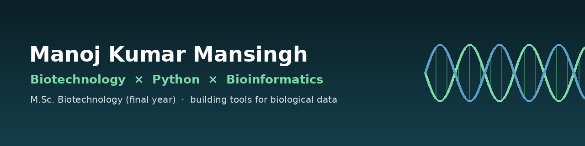

 

*I turn sequences and spreadsheets into answers, and sometimes into software.*

 

---

## ✨ About Me

I am a final-year M.Sc. Biotechnology student interested in the point where molecular biology meets code: sequence analysis, biological data handling, and the small tools that make both less tedious.

My background spans molecular biology and laboratory work. I have also taught as a special educator, which shaped how carefully I document and explain things. Alongside my degree I build software: a Python toolkit for DNA sequence analysis, and a couple of deployed web apps.

I am looking for entry-level roles and research assistantships in QA/QC, diagnostics or bioinformatics. I am based in Odisha.

---

## 🧬 Featured Project: DNA Sequence Analysis Toolkit

A dependency-free Python toolkit for common DNA analyses, with both a command line and a Streamlit web interface. No NumPy, no Biopython: every calculation is written out so the biology is visible in the code.

What it does:

- **DNA sequence statistics**: length, base composition and approximate molecular weight
- **GC content**, with ambiguous bases excluded from the denominator
- **Reverse complement**, handling mixed case and N
- **Transcription**, converting DNA to RNA
- **Translation** in any reading frame, using the standard genetic code
- **ORF detection** across all three frames on both strands, with configurable start codons
- **Restriction-site analysis** for 12 common enzymes, including sites spanning the origin of a circular molecule
- **k-mer counting** for any k

Repository: **[github.com/manojkumarmansingh/dna-sequence-toolkit](https://github.com/manojkumarmansingh/dna-sequence-toolkit)**

There is no hosted demo for this project yet. To run it locally, clone the repository and follow the README.

---

## Other projects

**CarbonWise** estimates an annual carbon footprint from transport, electricity, flights and diet, then gives tailored advice. Built with Next.js, React and TypeScript.

[Live demo](https://carbonwise-sigma.vercel.app) · [Source](https://github.com/manojkumarmansingh/carbonwise)

**Smart Lab Assistant** generates lab procedures, material lists and safety notes for students through a serverless API. Built with HTML, JavaScript and a serverless function.

[Live demo](https://smart-lab-assistant.vercel.app) · [Source](https://github.com/manojkumarmansingh/Smart-Lab-Assistant)

---

## 🛠️ Tools I work with

---

## 📊 GitHub Stats

My contribution graph, activity and full repository list live on GitHub:

**[View my GitHub profile](https://github.com/manojkumarmansingh)**

---

## 📬 Connect with Me

---

*Open to conversations about QA/QC, diagnostics and bioinformatics roles.*

